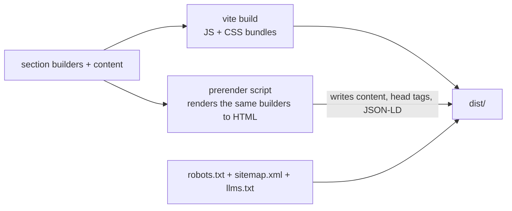
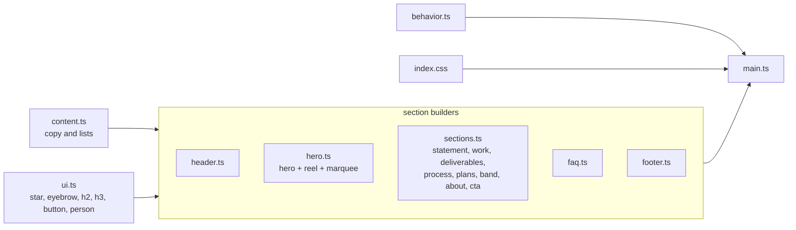
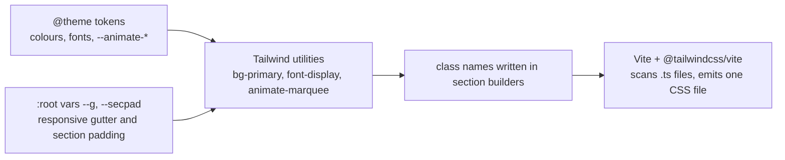
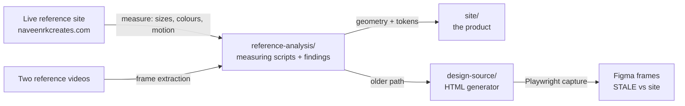
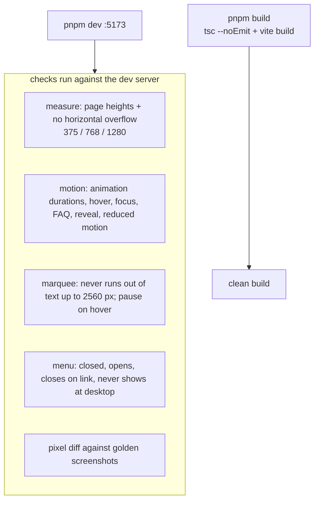

# Architecture

How the Lumen & Co. portfolio is built, how data flows through it, and how it is checked.
"Now" is what exists today. "Target" is what the reorganisation (see `REORGANIZATION-PLAN.md`) produces.
Why each choice was made is in `DECISIONS.md`.

## 1. What this project is

A one-page marketing site for a fictional personal-branding studio, "Lumen & Co.". It is modelled on a live reference site (https://naveenrkcreates.com/) with **our own copy and our own assets only**.

- **Stack:** TypeScript, Tailwind CSS v4, Vite, pnpm. No UI framework, no animation library.
- **Runtime JavaScript:** about 60 lines (mobile menu, FAQ accordion, scroll reveal). Everything else is HTML strings plus CSS.
- **Package rule:** only official publishers (vite, typescript, tailwindcss, @tailwindcss/vite). No React, no third-party or `@types` packages.

## 2. Runtime flow (what happens in the browser)


Consequence: the page is blank until the JS bundle runs (no prerender). Decision D-05, superseded by D-20: Step 5 adds a build-time prerender, so the finished HTML is already in the file and the browser only attaches behavior. Target build flow:



SEO and AEO background: `SEO-AEO-GUIDE.md`.

## 3. Module map and dependency rule (Now)



Rule: **dependencies point one way**: content and ui feed the section builders, the builders feed `main.ts`. `behavior.ts` never imports sections. It finds elements through the DOM hooks listed in section 6.

### Target layout

```
site/src/
  main.ts                  assemble + start behavior
  styles/theme.css         tokens (@theme), keyframes, base rules: the only place colours/fonts/animations are defined
  content/                 one file per section: all copy, typed; no copy anywhere else
  components/              small pure helpers: button, eyebrow, heading, star, person
  sections/                one file per section (header, hero, reel, marquee, statement, work, ...)
  behavior/                mobile-menu, faq-accordion, scroll-reveal (+ index that starts all)
site/tests/                the checks, as tests, plus golden screenshots
```

## 4. Styling architecture



- Colours, fonts and animations are defined **once**, in `@theme`.
- Gutter `--g` and section padding `--secpad` are CSS variables with breakpoints: 20 px below 640, 32 px from 640, and on desktop `max(48px, (100vw - 1084px) / 2)`.
- Heading sizes are fluid (`clamp` / `vw`), not fixed per breakpoint.
- Tailwind finds classes by scanning source text, so **class names must be written out in full** (no `text-${size}` string building).
- Tailwind v4 notes that affect this code: `rotate-*` and `-translate-*` set the separate `rotate` and `translate` properties, not `transform`, and `hover:` only applies on devices that can hover.

## 5. Motion architecture

| Effect | How | Reduced motion |
|---|---|---|
| Hero entrance (pill, h1, text, buttons), scribble underline, glowing dot | CSS keyframes (`rise`, `scribble`, `glow`) | animation removed, content visible |
| Reel columns (34 / 41 / 48 / 44 s), floating card (7 s) | CSS keyframes (`feed`, `float`) | animation removed, duplicate tiles hidden |
| Marquee (60 s, two rows, opposite directions) | CSS keyframes (`marquee`); each row holds 6 copies of its text and moves -50% so it never runs out | animation removed |
| Marquee pause | `group-hover:` pauses the hovered row only | n/a |
| Scroll reveal | `behavior/reveal`: adds `.reveal`, then `.in` when visible | skipped entirely |
| FAQ open/close | `data-open` plus a CSS grid-rows transition | transitions removed |

There is no animation library. Every `animate-*` has `motion-reduce:animate-none`.

## 6. DOM hook contract

`behavior.ts` and the checks depend on these names. Renaming one without updating the other breaks a check.

| Hook | Used by |
|---|---|
| `[data-site-header]`, `data-menu-open`, `[data-menu-toggle]`, `#mobile-menu` | menu behavior, menu check |
| `.faq`, `.faq-q`, `data-open`, `aria-expanded` | FAQ behavior, motion check |
| `[data-reveal] > *`, `.reveal`, `.in` | reveal behavior, motion check |
| `.rdup` | reduced-motion check (duplicate tiles hidden) |
| `.btn-p`, `.btn-s`, `.btn-w` | hover checks |
| `#top`, `.about-photo`, `section[aria-label="What we do"]` | motion and marquee checks |

## 7. Where the design comes from (data flow)



The site is the source of truth. The older design generator and the Figma frames were built from earlier reference numbers and **no longer match the site** (new palette, container, type scale, reel). Re-syncing them is a separate task.

## 8. How it is verified



Today these are loose scripts in `site/tests/legacy-scripts/`. Target: one command that runs all of them from `site/tests/` with `@playwright/test`, a dev-only dependency that is never part of the built site (D-15). The tests and their golden screenshots are not tracked by git (D-18).

## 9. Repo layout

**Now (after Step 1):** `site/` (product, checks in `site/tests/`), `dev-tools/`, `reference-analysis/`, `design-source/` (stale), `docs/`, `archive/` (dead files, git-ignored). Site refactor and docs rewrite (Steps 2a-2c) still to do.

**Target:** see `REORGANIZATION-PLAN.md`.
