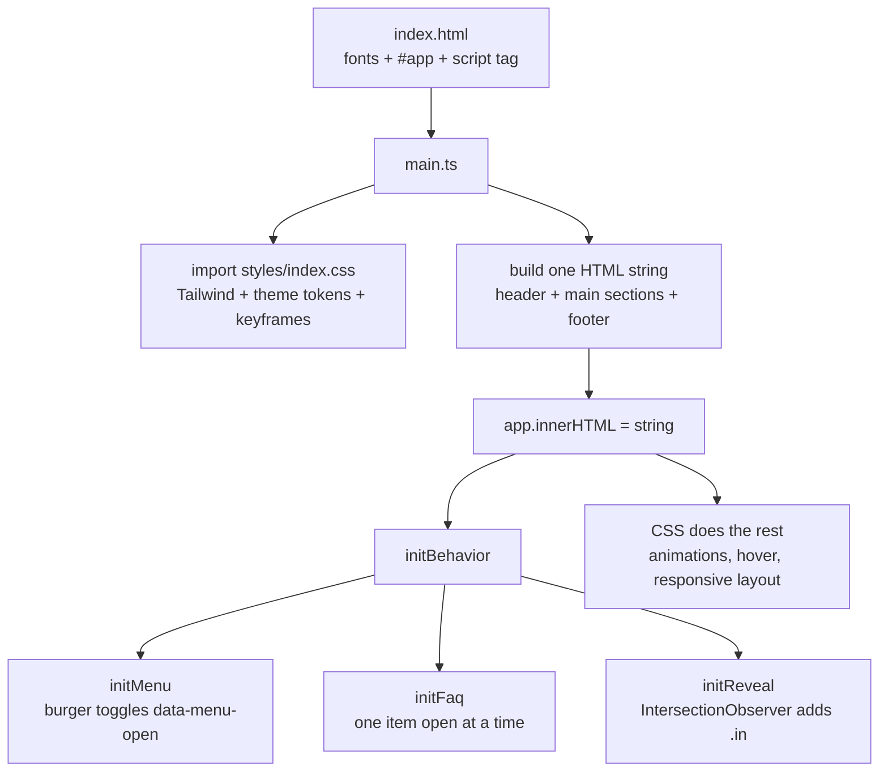
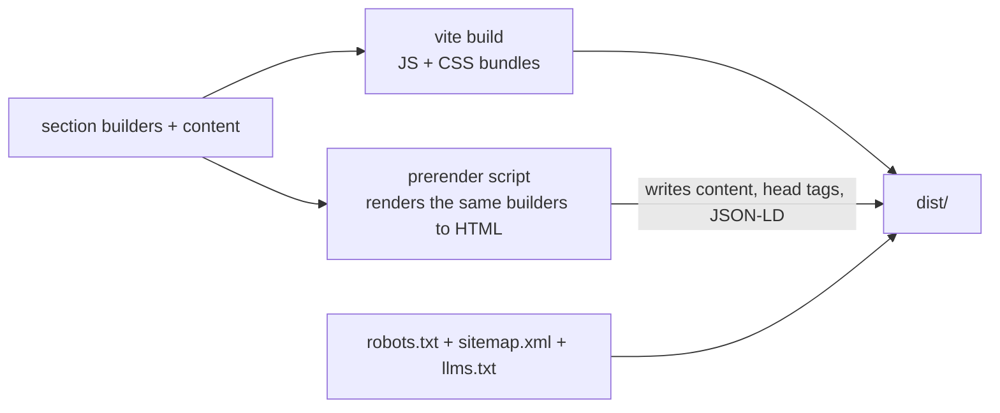
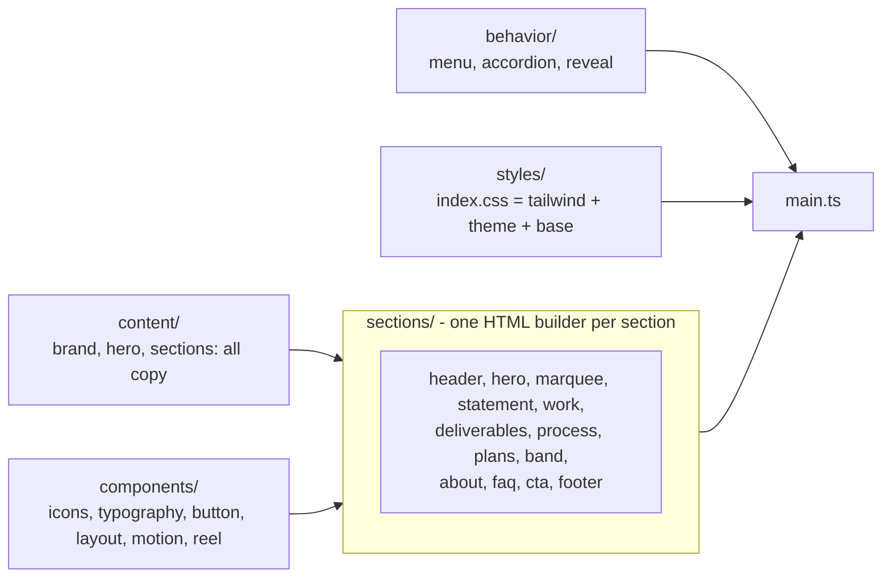
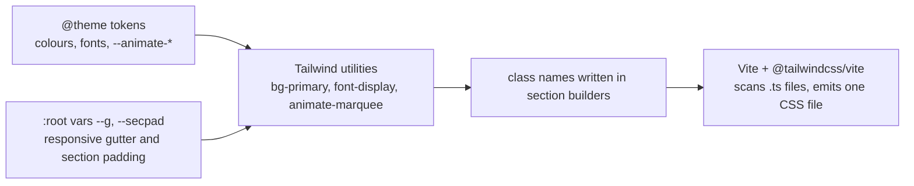
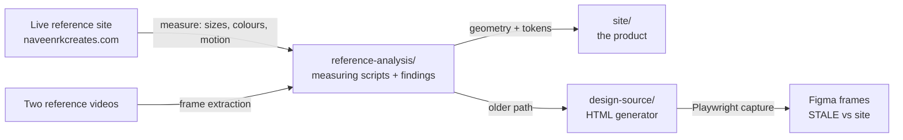
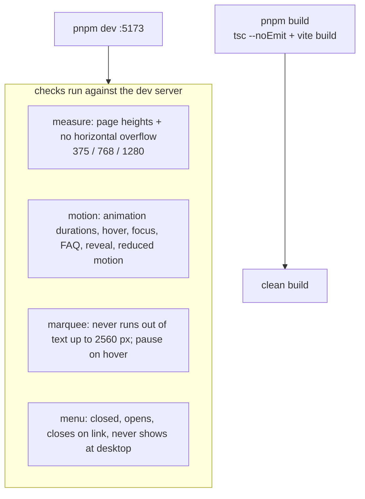

# Architecture

How the Lumen & Co. portfolio is built, how data flows through it, and how it is checked.
"Now" is what exists today. "Target" is what the reorganisation (see `REORGANIZATION-PLAN.md`) produces.
Why each choice was made is in `DECISIONS.md`.

## 1. What this project is

A one-page marketing site for a fictional personal-branding studio, "Lumen & Co.". It is modelled on a live reference site (https://naveenrkcreates.com/) with **our own copy and our own assets only**.

- **Stack:** TypeScript, Tailwind CSS v4, Vite, pnpm. No UI framework, no animation library.
- **Runtime JavaScript:** about 60 lines (mobile menu, FAQ accordion, scroll reveal). Everything else is HTML strings plus CSS.
- **Package rule:** only official publishers (vite, typescript, tailwindcss, @tailwindcss/vite). No React, no third-party or `@types` packages.

## 2. Runtime flow (what happens in the browser)



Consequence: the page is blank until the JS bundle runs (no prerender). Decision D-05, superseded by D-20: Step 5 adds a build-time prerender, so the finished HTML is already in the file and the browser only attaches behavior. Target build flow:



SEO and AEO background: `SEO-AEO-GUIDE.md`.

## 3. Module map and dependency rule



Rule: **dependencies point one way**: content and components feed the section builders, the builders feed `main.ts`. `content/` is data only (it imports nothing except its own types); `components/` and `sections/` read from it. `behavior/` never imports sections; it finds elements through the DOM hooks listed in section 6 and takes its two labels from `content/brand.ts`.

### Folder layout (done in Step 2a)

```
site/src/
  main.ts                  assemble the page, then start behavior
  styles/index.css         imports Tailwind (scan limited to src/), theme.css and base.css
  styles/theme.css         tokens (@theme): colours, fonts, keyframes and --animate-*; the brand block to swap on a rebrand
  styles/base.css          base rules, responsive variables (--g, --secpad), .reveal
  content/brand.ts         brand name, nav, footer, shared labels
  content/hero.ts          hero, reel and marquee copy
  content/sections.ts      copy for every section below the hero, plus lists (clips, steps, plans, faqs)
  content/types.ts         AccentedHeading = lead + accent + tail
  components/              icons, typography (eyebrow, h2, h3, head, accented), button, layout, motion, reel
  sections/                one file per section
  behavior/                menu, accordion, reveal, require-element, index (starts all)
site/tests/                the checks, as tests, plus golden screenshots (git-ignored)
```

Content strings are raw HTML (`&amp;`, `<br />`, typographic quotes are written as they render). A heading is `{ lead, accent, tail? }`; `accented()` wraps the accent in the italic accent style.

## 4. Styling architecture



- Colours, fonts and animations are defined **once**, in `@theme`.
- Gutter `--g` and section padding `--secpad` are CSS variables with breakpoints: 20 px below 640, 32 px from 640, and on desktop `max(48px, (100vw - 1084px) / 2)`.
- Heading sizes are fluid (`clamp` / `vw`), not fixed per breakpoint.
- Tailwind finds classes by scanning source text, so **class names must be written out in full** (no `text-${size}` string building).
- Tailwind v4 notes that affect this code: `rotate-*` and `-translate-*` set the separate `rotate` and `translate` properties, not `transform`, and `hover:` only applies on devices that can hover.

## 5. Motion architecture

| Effect | How | Reduced motion |
|---|---|---|
| Hero entrance (pill, h1, text, buttons), scribble underline, glowing dot | CSS keyframes (`rise`, `scribble`, `glow`) | animation removed, content visible |
| Reel columns (34 / 41 / 48 / 44 s), floating card (7 s) | CSS keyframes (`feed`, `float`) | animation removed, duplicate tiles hidden |
| Marquee (60 s, two rows, opposite directions) | CSS keyframes (`marquee`); each row holds 6 copies of its text and moves -50% so it never runs out | animation removed |
| Marquee pause | `group-hover:` pauses the hovered row only | n/a |
| Scroll reveal | `behavior/reveal`: adds `.reveal`, then `.in` when visible | skipped entirely |
| FAQ open/close | `data-open` plus a CSS grid-rows transition | transitions removed |

There is no animation library. Every `animate-*` has `motion-reduce:animate-none`.

## 6. DOM hook contract

`behavior/` and the checks depend on these names. Renaming one without updating the other breaks a check.

| Hook | Used by |
|---|---|
| `[data-site-header]`, `data-menu-open`, `[data-menu-toggle]`, `#mobile-menu` | menu behavior, menu check |
| `.faq`, `.faq-q`, `data-open`, `aria-expanded` | FAQ behavior, motion check |
| `[data-reveal] > *`, `.reveal`, `.in` | reveal behavior, motion check |
| `.rdup` | reduced-motion check (duplicate tiles hidden) |
| `.btn-p`, `.btn-s` | hover checks |
| `#top`, `.about-photo`, `section[aria-label="What we do"]` | motion and marquee checks |

## 7. Where the design comes from (data flow)



The site is the source of truth. The older design generator and the Figma frames were built from earlier reference numbers and **no longer match the site** (new palette, container, type scale, reel). Re-syncing them is a separate task.

## 8. How it is verified



`cd site; pnpm test` runs these as 17 specs in `site/tests/e2e/` with `@playwright/test`, a dev-only dependency that is never part of the built site (D-15). The tests and their golden screenshots are not tracked by git (D-18). Pixel diff against the golden screenshots is not automated: `site/tests/legacy-scripts/pixdiff.mjs` has no spec and must be run by hand.

## 9. Repo layout

Current tree (after Step 1; `git` ignores the folders marked *ignored*, see `README.md`):

```
Portfolio2/
  README.md  .gitignore
  site/                       product: Vite + TypeScript + Tailwind v4 (pnpm)
    index.html  package.json  tsconfig.json  vite.config.ts
    src/                      main.ts, styles/, content/, components/, sections/, behavior/ (section 3)
    tests/                    ignored: e2e/ (specs), legacy-scripts/, baseline/ (golden), output/, snapshot-dom.mjs, README.md
  dev-tools/                  browser.mjs (Playwright for helper scripts), range-server.mjs, package.json
  reference-analysis/         measuring the live reference
    scripts/  data/  specs/   tracked
    videos/  screenshots/     ignored
  design-source/              old design + Figma pipeline, STALE vs the site
    scripts/  sections/  older/  tokens.*  responsive*.html  states.html  design-spec.md
    screenshots/              ignored
  docs/                       ARCHITECTURE, DECISIONS, REORGANIZATION-PLAN, REFERENCE-NOTES,
                              FIGMA-HANDOFF, SEO-AEO-GUIDE, CONTENT-INTAKE, FILE-MANIFEST (historical)
  archive/                    ignored: paper-era/, scratch/, design-export-duplicates/,
                              unused-python-libs/, pre-reorg-backup zip
  tools/                      empty leftover folder (locked by a process), to be removed
```

`site/src` layout: see section 3.
