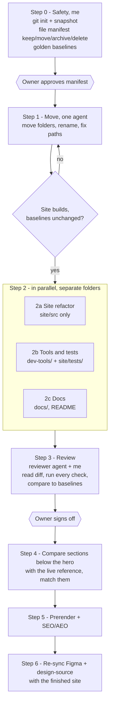

# Reorganization plan

Goal: one clear structure for code, folders and docs, with **no visual change** to the site.
Status: Step 0 and Step 1 done (2026-11-08). Step 2 done: 2a site refactor (rendered DOM and CSS byte-identical), 2b `pnpm test` (17 specs pass), 2c docs. `pixdiff` was not ported to a spec (run by hand). Step 3 review done (2026-11-08): no DOM or CSS regression from the refactor; fixed `range-server` crash and exposure, stale docs. That review only caught four copied labels; Step 4 found 48 exact matches with the reference and rewrote all placeholder copy (`reference-analysis/scripts/copy-overlap.mjs` is the check). Step 4 done and accepted by the owner (2026-11-08): copy rewritten, sections below the hero follow the reference's layout rules at 375 / 768 / 1280, mobile clip row swipes, menu and FAQ accessibility fixes (D-26). Golden baselines refreshed (old ones in `archive/pre-step4-baseline/`); all 18 specs pass. Step 5 done (2026-11-19, D-27): prerender plus head tags, JSON-LD, robots/sitemap/llms.txt; 23 specs pass; speed unchanged for people, CLS 0.149 open. The site address is a placeholder until O-11. Fonts self-hosted, layout shift 0.036 (D-28). Step 6 done (2026-11-19, D-29): four v3 Figma frames captured from the built site; old design files archived; old v1/v2 and states-sheet Figma frames deleted, so the Figma file holds only the four v3 frames. Architecture is in `ARCHITECTURE.md`, reasons in `DECISIONS.md`.

## 1. Problems this fixes

| Area | Today | Problem |
|---|---|---|
| Root | 2 videos (100 MB), 4 overlapping spec files, `PAPER-MCP.md`, `SSofdesktop/`, `.libs` | No entry point; same specs copied again in `design-export/` |
| `tools/` | 88 files, flat | About half are dead Paper-era leftovers; the rest mixes site checks, reference analysis and Figma export; Chrome path, ports and `D:/` paths repeated per script |
| `screenshots/` | 439 files, 77 MB | Reference, Paper, Figma, our site and video frames mixed |
| `design-export/` | Old design (Figma source) | Stale vs the site; duplicate tokens |
| `site/` | Good structure to build on | `dev.log` and `dist/` in the tree, no `.gitignore`, no git |
| `site/src` | 10 flat files | `hero.ts` holds hero, reel and marquee; copy split between `content.ts` and inline; checks live outside the project |

There is **no git**, so a 500-file reorganisation has no undo. Step 0 fixes that first.

## 2. Target layout

```
Portfolio2/
  README.md
  site/                     product (Vite + TS + Tailwind, pnpm)
    src/{main.ts, styles/, content/, components/, sections/, behavior/}
    tests/                  checks + golden screenshots
  design-source/            old design-export: generator + Figma notes (marked stale)
  reference-analysis/       videos, specs, screenshots, reference-measuring scripts
  dev-tools/                only scripts still in use + one shared browser/config helper
  docs/                     ARCHITECTURE, DECISIONS, this plan, merged specs
  archive/                  Paper-era dead code and scratch scripts, kept until the owner decides (D-14)
```

Script rename rule (verbose names): `ref-reel2.mjs` becomes `measure-reference-hero-reel.mjs`, `cmp-sections.mjs` becomes `compare-section-heights-site-vs-design.mjs`, and so on.

## 3. First read of `tools/` (to be verified in step 0 by searching for references)

| Group | Files (by name) | Goes to |
|---|---|---|
| Site checks, in use | `measure-site`, `pixdiff`, `verify-motion`, `check-marquee`, `check-menu`, `cmp-sections`, `range-server` | `site/tests/` and `dev-tools/` |
| Reference analysis, in use | `ref-*.mjs` (11), `site-timeline`, `measure-interactions`, `video-frames`, `hero-shots` | `reference-analysis/scripts/` |
| Figma pipeline, in use | `figma-capture`, `render-responsive`, `gen-responsive`, `export-design` | `design-source/` |
| Scratch, probably dead | `dbg`, `dbg2`, `our-marquee`, `probe*`, `radii*`, `tokens2`, `measure`, `capture` | `archive/scratch/` |
| Paper-era, dead | `paper/`, `paper.mjs`, `pp*.mjs`, `ins`, `add`, `fix`, `gen`, `c*.json`, `_*.json`, `patch*.py`, `tools.json`, `guide.txt`, `local-*` | `archive/paper-era/` |

Nothing is deleted in this plan (D-14). The owner decides about `archive/` afterwards.

## 4. Workflow: 4 workers at most

Most of the work is sequential. Each agent starts cold, so more agents would not be faster. One gate, one solo step, then three in parallel, then a reviewer.



| Step | Who | Work | Done when |
|---|---|---|---|
| 0 Safety | me | Write `.gitignore` first (D-18). `git init`, snapshot commit of the site and docs. Zip the current `tools/` into `archive/` (git will not track it). Manifest of every file. Golden baselines: screenshots at 375 / 768 / 1280, page heights, motion-check output (kept in the untracked `site/tests/`) | **Owner approves the manifest** |
| 1 Move | one agent (or me) | Move folders, rename scripts, fix every path. Runs alone: it touches paths everywhere | Site builds and baselines unchanged |
| 2a Site refactor | builder agent | Split `hero.ts` and `sections.ts` into `components/`, `sections/`, `content/`, `behavior/`. All copy into `content/`. Dedupe class strings. Single `theme.css` | Golden screenshots and heights match exactly |
| 2b Tools and tests | builder agent | One shared helper (browser launch, URLs, widths). Turn verify, marquee, menu, pixdiff into `@playwright/test` specs in `site/tests/` (dev-only, D-15) | One command runs all checks; `dist/` contains no test code |
| 2c Docs | builder agent | `README.md`, `docs/`, mark stale design files | One README explains the repo |
| 3 Review | reviewer agent + me | Read the full diff, re-run every check, compare against baselines | Clean report |

Parallel rule: 2a, 2b, 2c write to different folders only. If 2b needs a selector change in `site/src`, it asks 2a instead of editing it.

## 5. Rules

- No visual change in the refactor (D-13). Improvements come after, on the clean base.
- Git ignores `archive/`, `site/tests/`, `reference-analysis/videos/` and all screenshots (D-16, D-18, D-21). Nothing in them is ever committed.
- Nothing is deleted; dead files move to `archive/` (D-14). Because git does not track them, a zip of `tools/` is made before step 1.
- Installs only from official publishers (D-03). Test tooling is dev-only and never shipped (D-15).
- Every moved script keeps working: the manifest step lists which script reads which path.

## 6. Step 4: right after the review (D-17)

Compare every section below the hero against the live reference and match it: statement, work, deliverables, process, plans, band, about, FAQ, call to action, footer. This is the first visual change after the refactor, so it starts from the golden baselines and refreshes them once the owner accepts the result.

## 7. Step 5: prerender and SEO/AEO (D-20)

Build-time prerender, head tags, JSON-LD, `robots.txt`, `sitemap.xml`, `llms.txt`, performance pass, answer-shaped copy review. Details and the reasoning are in `SEO-AEO-GUIDE.md`, section 6. The site is for a real business (D-22), so the real facts come from `CONTENT-INTAKE.md`. Step 5 can be built with placeholder data and the real facts swapped in at the end. Search bots are allowed (D-23); O-09 (training bots) can be answered any time before launch. O-10 (brand identity), O-11 (hosting and domain) and O-12 (who supplies content) settled before launch. It adds a build step, so `ARCHITECTURE.md` gets a "build flow" diagram when it ships.

## 8. Step 6: re-sync Figma and `design-source/` (D-19)

Done (D-29). Instead of regenerating design HTML, the built site is captured into Figma directly, so there is no second design to keep in sync. Last, so the design copies a stable result.

## 9. Out of scope for this plan

A framework change; new pages beyond the one-page site.

## 10. Open questions

O-09 to O-12 in `DECISIONS.md`. All four are needed before launch, none before Step 5 can be built. Nothing blocks Steps 0 to 4.
