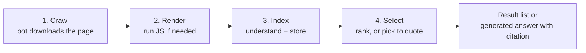

# SEO and AEO: a working guide for this site

Written for learning first, building second. Section 6 says what we will build and when.
Facts below come from Google's own documentation where stated; claims that rest only on vendor blogs are marked **(unverified)**. Both fields change quickly, so re-check dates before acting.

## 0. The honest framing

- Nobody can guarantee a ranking or an AI citation. Anyone who does is selling something.
- Google says its AI features (AI Overviews, AI Mode) have **no special requirements beyond normal Search**: a page must be indexed and eligible to show with a snippet. Same index, same foundations.
- So "AEO" is not a separate trick. It is SEO foundations plus content shaped like answers, facts a machine can read, and not blocking the bots that matter.

## 1. The terms

| Term | Meaning | Where the result shows up |
|---|---|---|
| **SEO** (search engine optimisation) | Getting your pages found and ranked in classic search results | Google, Bing result lists |
| **AEO** (answer engine optimisation, also called GEO) | Getting your content used as, or cited in, a generated answer | Google AI Overviews and AI Mode, ChatGPT search, Claude, Perplexity |
| **Crawler / bot** | A program that downloads pages | Googlebot, Bingbot, OAI-SearchBot ... |
| **Index** | The engine's database of pages it has understood | |
| **Structured data** | Machine-readable facts (JSON-LD, schema.org vocabulary) | |
| **Entity** | A "thing" the engine recognises: your business, your founder, your service | |

## 2. How an engine gets from your page to an answer

A page can fail at any stage, and you fix them in this order. **Our site used to fail at stage 2**: the HTML a bot downloaded was an empty `
`, and the content only appeared after JavaScript ran. Step 5 fixed that: the built `dist/index.html` contains the whole page. Google can run JavaScript, though later and less reliably. Many other crawlers are reported not to run it **(unverified)**. Prerendering puts the finished HTML in the file so stages 1 and 2 cannot fail.

## 3. The six layers and what each means for this site

### A. Technical: can a bot read and trust the page?
- Prerendered HTML (the content is in the file). *Step 5.*
- One canonical URL, correct status codes, HTTPS, `lang="en"` on `<html>`.
- `robots.txt` and `sitemap.xml`.
- Speed and stability (Core Web Vitals: LCP loading, CLS layout shift, INP responsiveness). Fonts and the hero need care here.

### B. On-page: does the page say clearly what it is?
- A unique `<title>` and meta description. One `<h1>`. Headings that nest in order.
- Descriptive link text ("Book an intro call", not "click here"). Real alt text on real images.
- Open Graph and Twitter tags, which control link previews.

### C. Structured data: facts a machine does not have to guess
- JSON-LD in the page head: `Organization` (or `ProfessionalService`), `WebSite`, `FAQPage` for the FAQ, optionally `Service`/`Offer` for the two plans.
- **Rule: only mark up what is visible on the page and true.** Fake reviews or invented addresses in markup is a policy violation.
- **FAQPage reality check:** Google stopped showing FAQ rich results on 7 May 2026. The markup is still valid schema.org and still helps machines read the page, but do not expect the old expandable results ([Priority Pixels](https://prioritypixels.co.uk/insights/google-ends-faq-rich-results-in-search/), [Search Engine Journal](https://www.searchenginejournal.com/google-drops-faq-rich-results/574429/); secondary sources quoting Google's documentation, so check the FAQPage page on Search Central).

### D. Answer-shaped content: the part that is most "AEO"
- Question as heading, **direct answer in the first one or two sentences**, detail after. Our FAQ already has this shape.
- Concrete facts: what you do, for whom, where, how long it takes, what it costs or how pricing works.
- One consistent name for the business and the person everywhere.
- Plain statements a model can quote without needing context. Vague marketing lines are not quotable.

### E. Bot access: who is allowed in
Blocking a bot also removes you from what it powers. Training and search are separate bots for the big vendors.

| Bot | Purpose | Blocking it means |
|---|---|---|
| Googlebot, Bingbot | Classic search; also feeds Google AI Overviews and Bing/Copilot answers | You vanish from search |
| OAI-SearchBot, Claude-SearchBot, PerplexityBot | Index pages for ChatGPT search, Claude and Perplexity answers | You cannot be cited there |
| GPTBot, ClaudeBot | Collect data for model training | Only keeps you out of future training; **does not** remove you from the search products above |
| ChatGPT-User, Claude-User, Perplexity-User | Fetch a page when a person asks about it | Person-triggered; Perplexity-User is reported to ignore robots.txt |
| Google-Extended | A robots.txt token, not a separate crawler: controls use for Gemini training and grounding | Does not affect Search or AI Overviews |

Source for the table: vendor-neutral roundups such as [Anagram's crawler list](https://www.anagram.ai/blog/ai-crawler-user-agent-list-2026-14-bots-and-robotstxt-tokens-to-know), which is a secondary source. Confirm each bot name on the vendor's own crawler page before you write `robots.txt`.

### F. Trust off the page: where most of the weight actually is
Engines choose whom to quote partly by who else vouches for you: consistent profiles (LinkedIn, Instagram, YouTube), real reviews, mentions on other sites, a real person with a real track record on the About section. Almost none of this is code.

## 4. What to skip, and one optional extra

**`llms.txt` (we include it, owner's decision, D-20).** It is a plain text or Markdown file at `/llms.txt` that summarises the site for language models. Google's guidance lists it as not needed, a 90-day test on ten sites found no measurable change in eight, and one reported analysis found 97% of such files got no traffic (secondary sources: [Contentful](https://www.contentful.com/blog/llms-txt-search-visibility/), [Ahrefs](https://ahrefs.com/blog?p=198700)). We still add it because it is nearly free and some tools and agents may read it. Treat it as a cheap extra, not a ranking lever, and generate it from the same copy file as the page so it never drifts.

| Do not | Why |
|---|---|
|---|---|
| Stuff keywords, hide text, or mass-produce filler copy | Policy violations, and models quote clear text better |
| Mark up content that is not on the page | Violates structured-data policy |
| Expect FAQ markup to bring rich results | Retired on 7 May 2026 |

## 5. How to measure

| Tool | Tells you | Cost |
|---|---|---|
| View-source (or `curl`) on the deployed page | Is the content in the raw HTML? The simplest and most important test | free |
| Google Search Console | Indexing status, search queries, clicks. Google says appearances in AI features count within overall Search traffic there ([Google: AI features](https://developers.google.com/search/docs/appearance/ai-features)) | free, needs a real domain |
| Bing Webmaster Tools | Same for Bing, which several answer engines draw on **(unverified)** | free |
| Lighthouse (Google's own tool) | Speed, accessibility, basic SEO checks | free |
| Asking the engines | Monthly, ask ChatGPT, Perplexity, Gemini and Claude about the business by name and by topic; log who gets cited | your time |

## 6. What we build, and when

Status: items 1 to 4 and the first two checks of item 7 are built (Step 5, D-27). Item 5 was measured but not changed (D-27, CLS 0.149 is open). Item 6 waits for real facts (D-22).

Order in `REORGANIZATION-PLAN.md`: cleanup (steps 0 to 3), compare the lower sections (step 4), then **step 5 = prerender plus this guide's layers A to E**, then Figma re-sync.

1. **Prerender at build time.** A small script renders the same section builders to HTML and writes them into `dist/index.html`. No new dependency: Vite (already installed) can load the TypeScript modules for the script. In the browser the page then skips re-rendering and only attaches the behavior. If the owner later wants more pages, revisit the tool choice.
2. **Head:** title, description, canonical, `lang`, Open Graph/Twitter tags.
3. **JSON-LD:** `Organization`/`ProfessionalService`, `WebSite`, `FAQPage`, from the same copy file as the visible text so they cannot drift apart.
4. **`robots.txt`, `sitemap.xml` and `llms.txt`:** with an explicit bot policy (owner decides training bots, see table in E). `llms.txt` is generated from the copy file.
5. **Performance pass:** font loading, hero stability, CLS and LCP measured with Lighthouse.
6. **Answer-shaped copy review:** direct first sentences, concrete facts. Needs real information from the owner.
7. **Checks:** raw HTML contains the content; JSON-LD parses and matches visible text; no console errors.

## 7. Real business: what that requires (D-22)

The site is for a real business (the owner's friend). Today the studio name, city and copy are placeholders. Structured data and `llms.txt` must not invent facts, and a placeholder business on an unregistered domain cannot be meaningfully ranked. So before Step 5 we need the real information in `CONTENT-INTAKE.md`, plus a domain (O-11). Until it arrives, Step 5 can still be built and tested with the placeholder data, and the real facts are swapped in at the end because they all live in the copy files.

Two things only the business can supply, and they matter more than any code: a distinct identity (O-10) and real proof such as work samples and testimonials used with permission.

## 8. Primary sources to read yourself, in this order

1. [Google: AI features and your website](https://developers.google.com/search/docs/appearance/ai-features)
2. [Google: Optimizing your website for generative AI features](https://developers.google.com/search/docs/fundamentals/ai-optimization-guide)
3. Google Search Central: SEO Starter Guide, and the structured data documentation for `Organization`, `FAQPage` and `Article`.
4. [schema.org](https://schema.org): the vocabulary behind JSON-LD.
5. Each vendor's own crawler page (OpenAI, Anthropic, Perplexity, Google) before writing `robots.txt`.
6. Bing Webmaster Guidelines.
